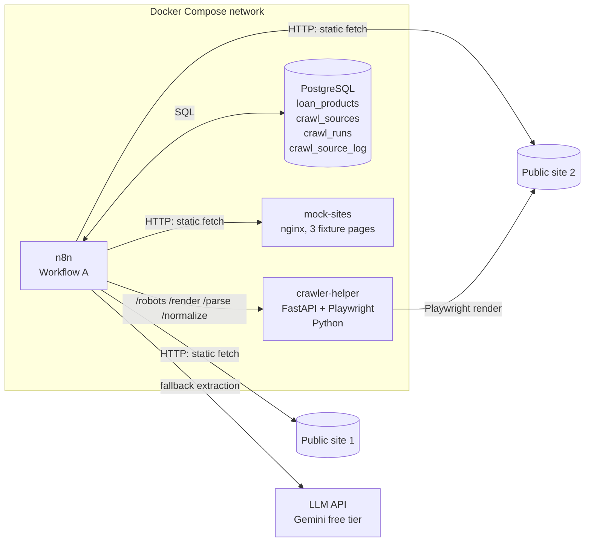
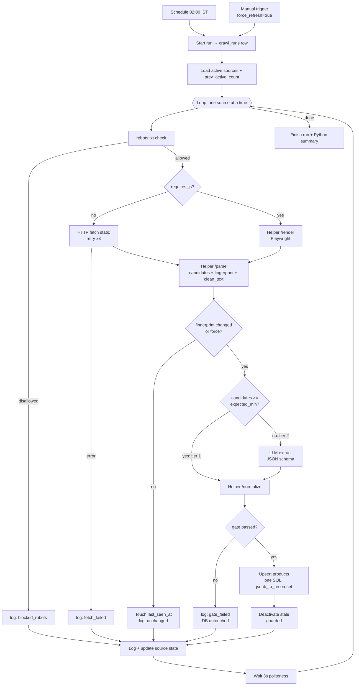

# Workflow A: Loan Product Discovery. Architecture & Design Plan

> **Audience:** the coding agent that will build this. Read this file first (the *what* and *why*), then `workflow-a-implementation.md` (the *how*: SQL, code, node-by-node n8n spec, tests).
> **Stack decision:** Python for all custom code. n8n orchestrates. Postgres stores. A small Python (FastAPI) helper service does the stateless heavy lifting. Everything runs locally via Docker Compose.

---

## 1. Purpose & scope

**Goal:** once a day (and on demand), autonomously discover personal-loan products from public finance websites, turn messy page content into clean structured rows, and keep the `loan_products` table accurate and current, so that Workflow B can match users against it.

**In scope**
- Scheduled + manual trigger
- Crawling 2-3 real public sites **plus 1 local mock site** (for a deterministic demo)
- Deterministic extraction (CSS selectors) with an **LLM fallback** when selectors fail
- Normalization and validation of rates, income, credit score, age, tenure, amounts
- Idempotent upserts, change detection, stale-product lifecycle
- Run logging, per-source failure isolation, sanity gates

**Out of scope**
- User ingestion (CSV/S3/Lambda), Workflow B matching, Workflow C email
- Full anti-bot evasion (we are polite crawlers, not scrapers that fight blocking)
- Handling every possible layout change (assignment says optional; we implement a *cheap, explainable* self-healing path, see §10)

**Why this design scores well:** the rubric weights "sophistication, robustness, efficiency of n8n workflows" and "creative use of n8n nodes for crawling, data manipulation and logic". So n8n must visibly own scheduling, branching, retries, LLM fallback, gating and DB writes. The Python helper is deliberately limited to *pure, stateless functions* (render, parse, normalize).

---

## 2. Contract with other workflows (do not break this)

Workflow B's SQL pre-filter reads `loan_products`. These semantics are the interface.

| Column | Type | Meaning for Workflow B |
|---|---|---|
| `product_id` | bigserial PK | Written into `matches.product_id` |
| `lender_name`, `product_name` | text | Used in the Workflow C email |
| `interest_rate_min/max` | numeric(5,2) | % p.a. Shown in email |
| `min_monthly_income` | numeric(12,2) | INR per month. **NULL = no stated requirement**, not "zero" |
| `min_credit_score`, `max_credit_score` | int | Bureau-style 300-900. NULL = no stated bound |
| `min_age`, `max_age` | int | NULL = no stated bound |
| `employment_types` | text[] | Subset of `{salaried, self_employed}`. **NULL/empty = any** |
| `eligibility_text` | text | Raw eligibility prose, kept for B's *LLM stage* on ambiguous cases |
| `is_active` | boolean | B **must** filter `is_active = true` |
| `source_url` | text | Link shown in email |

**Vocabulary alignment:** `employment_types` values must match the `employment_status` vocabulary used in the users CSV (`salaried`, `self_employed`). If the CSV uses different strings, add a mapping in one place (the normalizer) and document it.

**Bootstrap rule:** Workflow A must have run at least once (or the seed fixture loaded) before Workflow B is demoed.

---

## 3. System architecture

### Responsibility split (the key design rule)

| Concern | Owner | Reason |
|---|---|---|
| Schedule, manual trigger, looping over sources | **n8n** | Visible, demoable orchestration |
| HTTP fetch of static pages, retries, timeouts | **n8n** HTTP Request node | Native retry/continue-on-error |
| Branching: JS or not, changed or not, selectors enough or LLM, gate pass or fail | **n8n** IF nodes | Shows workflow sophistication |
| LLM fallback call | **n8n** HTTP Request node | Cost control stays visible |
| All DB reads/writes | **n8n** Postgres nodes | Single place for state |
| robots.txt check, JS rendering, HTML parsing, normalization, validation, grounding check | **Python helper** | Needs libraries (bs4, lxml, Playwright); unit-testable |
| Run summary aggregation | **n8n** Python Code node | Python in n8n too |

The helper holds **no state and no credentials**. Every endpoint is a pure function of its request.

---

## 4. Pipeline stages (per source)

Every terminal branch converges on **one** "Log Source Result" node → "Update Source State" → "Wait" → back to the loop. This guarantees a failure on one source never stops the others.

---

## 5. Crawl strategy

### 5.1 Source selection
Pick **2 real + 1 mock**. The agent must verify each live source before committing (open it, check `robots.txt`, check whether product data is in the initial HTML or JS-rendered).

| Candidate (India, personal loans) | Notes for the agent |
|---|---|
| Aggregator comparison pages (e.g. BankBazaar, Paisabazaar) | Rich data, but frequently JS-rendered and may restrict automated access. Check ToS/robots first |
| A bank's own personal-loan page (e.g. HDFC, SBI, ICICI, Axis) | Usually server-rendered, few products, stable. Good "static" example |
| **`mock-lender-hub` (local nginx)** | **Mandatory.** Deterministic, always up, 3 fixture pages with different layouts. Powers the demo and the tests |

**Hard rule:** if a real site disallows crawling in `robots.txt` or its terms prohibit automated access, drop it and replace it with another. Do not work around it. The mock site guarantees the pipeline is still demonstrable.

> Do not invent CSS selectors from memory. Fetch the live page, inspect it, and write selectors against what is actually there. If selectors can't be made reliable, set that source to `extraction_mode='llm'`, which is a legitimate strategy, not a failure.

### 5.2 Politeness
- Identify honestly: `User-Agent: LoanDiscoveryBot/1.0 (+contact email)`
- Honor `robots.txt` (helper `/robots`; fail **closed** if robots.txt is unreachable with 5xx, treat 404 as allowed)
- One request at a time, **3 s wait** between sources, respect `Crawl-delay` if present
- Runs **once daily**; conditional fetch not needed because fingerprinting skips downstream cost anyway
- Timeout 30 s static, 45 s render

### 5.3 Fetching
- **Static:** n8n HTTP Request node, `Retry On Fail` = 3 tries, 5 s apart, `On Error` = *Continue (using error output)*, response as text.
- **JS-rendered:** helper `/render` launches headless Chromium (Playwright), waits for a per-source `wait_selector` (else network idle), returns post-render HTML.
- Only `requires_js = true` sources pay the browser cost.

---

## 6. Extraction strategy (two tiers)

### Tier 1: deterministic selectors (free, fast, preferred)
Per-source `selector_config` JSONB in `crawl_sources` describes a `card` selector and a `fields` map. The helper's `/parse` applies it with BeautifulSoup/lxml and returns **raw strings**, not interpreted values. Adding a new source = inserting a row, no code change.

### Tier 2: LLM fallback (only when Tier 1 is insufficient)
Triggered when `candidates < expected_min_products` (selectors broke, never existed, or the source is `extraction_mode='llm'`).
- Input is the helper's **`clean_text`** (scripts, styles, nav, footer stripped; truncated to ~20k chars), not raw HTML. This cuts tokens by roughly 10x.
- Structured output via JSON schema, temperature 0.
- The LLM is told to **copy values verbatim** (e.g. `"10.49% - 24% p.a."`), not compute or convert. Conversion stays deterministic in the normalizer.

### Hallucination guard ("grounding check")
For LLM-sourced candidates, `/normalize` verifies that each numeric field's raw snippet **actually appears in the page text** (whitespace/case-normalized). Ungrounded numeric fields are nulled with a warning; an ungrounded `product_name` rejects the record. This is cheap and makes the LLM tier safe to trust.

### LLM cost controls (the "optimization" angle for Workflow A)
1. Fingerprint unchanged → LLM never called.
2. Selectors succeed → LLM never called.
3. Only the cleaned main text is sent.
4. One call per *source page*, not per product.
5. Expected steady state: **0 LLM calls/day**; LLM is insurance.

(Workflow B's treasure hunt is separate, but A's `eligibility_text` column feeds it.)

---

## 7. Normalization & validation rules

All done in the helper's `normalize.py`, unit-tested.

| Field | Raw examples | Normalized |
|---|---|---|
| Interest rate | `10.49% - 24% p.a.`, `from 10.99%`, `Starting at 11%` | `min=10.49, max=24.00` / `min=10.99, max=NULL` |
| Income | `₹25,000`, `Rs. 1.5 Lakh`, `25k per month`, `INR 30,000/month` | numeric INR/month (`25000`, `150000`, `25000`, `30000`) |
| Credit score | `700+`, `CIBIL 750 and above`, `650-750` | `(700,NULL)`, `(750,NULL)`, `(650,750)`; only numbers in 300-900 considered |
| Age | `21 to 60 years`, `21-58` | `(21,60)`, `(21,58)` |
| Loan amount | `₹50,000 to ₹40 Lakh`, `up to 25 lakh` | `(50000,4000000)`, `(NULL,2500000)` |
| Tenure | `12 to 60 months`, `1-5 years` | months: `(12,60)`, `(12,60)` |
| Employment | `Salaried`, `Self-employed professionals` | `{salaried}`, `{self_employed}`; none stated → NULL |
| `product_key` | lender + product name | `slugify("hdfc-bank-personal-loan")` |

**Reject a record when:** no product name; rate outside (0, 60]; income outside [0, 10,000,000]; score outside 300-900; any min > max; **or** neither an interest rate nor any eligibility criterion is present (`insufficient_data`).
**Warnings (kept, confidence reduced):** ungrounded field, unparseable field set to NULL.
**Confidence:** `populated_key_fields / 6` minus 0.1 per warning, floored at 0. Key fields: rate, income, credit score, loan amount, tenure, employment.

Rejected records are never silently dropped: a sample (max 5) is stored in `crawl_source_log.rejected_sample` for debugging.

---

## 8. Change detection & idempotency

- **Fingerprint** = SHA-256 of whitespace-normalized text of the product cards (if cards found) or of the cleaned body text. It deliberately ignores scripts, nonces, timestamps and page chrome.
- `crawl_sources.last_content_hash` stores the last **successfully processed** fingerprint. It is updated only after a successful upsert, so a failed run retries next time.
- If unchanged: skip parse→normalize→upsert, but **touch `last_seen_at`** for that source's active products (otherwise the stale logic would wrongly deactivate them).
- **Upsert key:** `UNIQUE (source_id, product_key)`. Re-running any number of times produces no duplicates.
- Per-row `content_hash` over business fields; `last_changed_at` only moves when the hash changes. This lets you later answer "which products changed rates this week".
- `force_refresh` (manual trigger default = true for demos) bypasses the fingerprint check.

---

## 9. Stale-product lifecycle

Products that disappear from a source must stop being matched, but a flaky crawl must not wipe the catalog.

1. A product seen in this run gets `last_seen_at = now()`.
2. After a **successful, gated** upsert, products of that source with `last_seen_at < run_started_at` are set `is_active = false` (soft delete, never `DELETE`).
3. **Gate (in `/normalize`):** deactivation and upsert happen only if
   `valid_count >= ceil(prev_active_count * 0.5)` and `valid_count > 0`.
   Otherwise the source is logged as `gate_failed` and **the DB is not modified**.
4. If a deactivated product reappears, the upsert sets `is_active = true` again.

---

## 10. Layout-change handling (self-healing, kept deliberately simple)

| Situation | Detection | Response |
|---|---|---|
| Selectors silently stop matching | `candidates < expected_min_products` | Tier 2 LLM extraction on `clean_text`; log `method=llm` |
| LLM also finds nothing / junk | `/normalize` returns 0 valid or gate fails | `gate_failed`, DB untouched, `consecutive_failures++` |
| Persistent breakage | `consecutive_failures >= 3` | Flagged in the run summary (and optional email alert) |
| Selectors partially match (some fields NULL) | Low average confidence | Recorded in `confidence`; visible in logs |

**Demo story (great for the video):** swap the mock site's `v1.html` for `v1_broken.html` (class names renamed). Run Workflow A: Tier 1 yields 0 candidates, n8n routes to the LLM branch, products still extract. This shows resilience without building a full self-repairing scraper.

---

## 11. Error handling matrix

| Failure | Where caught | Behavior |
|---|---|---|
| robots disallows | IF after `/robots` | `blocked_robots`; skip source |
| HTTP 4xx/5xx / timeout | HTTP node error output (after 3 retries) | `fetch_failed`; continue to next source |
| Helper down | HTTP node error output | `parse_failed`; continue; run marked `partial` |
| Selectors yield 0 | IF | LLM fallback |
| LLM API error / invalid JSON | HTTP error output / Python parse | `parse_failed` |
| All records rejected / gate fails | IF after `/normalize` | `gate_failed`; DB untouched |
| DB write error | Postgres node error output | `db_failed`; source state NOT advanced (hash not updated) |
| Whole workflow crash | n8n **Error Workflow** (`workflow_a_error_handler`) | Marks the `crawl_runs` row `failed`; optional SES alert |

Principle: **one source failing must never block or corrupt another source or the existing catalog.**

---

## 12. Observability

- `crawl_runs`: one row per execution (status `running | success | partial | failed`, counts, timing).
- `crawl_source_log`: one row per source per run (status, method, HTTP status, candidates/valid/rejected counts, inserted/updated/deactivated, duration, error, rejected sample).
- Handy demo query: `SELECT source, status, method, valid_count, inserted, updated FROM v_last_run;` (view defined in implementation doc).
- n8n execution history retained (`EXECUTIONS_DATA_SAVE_ON_ERROR/SUCCESS=all` for the demo).

---

## 13. Security & configuration

- Secrets (DB password, LLM API key) live in **n8n credentials** and `.env`, never in workflow JSON or git. Provide `.env.example`.
- n8n encryption key fixed via `N8N_ENCRYPTION_KEY`, so credentials survive container rebuilds.
- Helper listens only on the internal Docker network (no published port in the "production-like" compose profile; publish for local debugging only).
- SQL values always passed as **query parameters**, never string-concatenated from scraped content. Scraped text is untrusted input.
- Scraped text sent to the LLM is **data, not instructions**: the system prompt says to ignore any instructions inside page text.
- Exported workflow JSON must be scrubbed of credential IDs/secrets before committing.

---

## 14. Performance & cost

- 3 sources × (1 fetch + 1 parse + 1 normalize + 1 upsert) per day. Seconds to a couple of minutes end to end.
- Single set-based upsert per source via `jsonb_to_recordset`, not one query per product.
- LLM calls: 0 in steady state; ≤1 per broken source per run.
- Indexes on `loan_products (is_active, min_monthly_income, min_credit_score)` make Workflow B's pre-filter fast.

---

## 15. Risks & mitigations

| Risk | Mitigation |
|---|---|
| Real sites are JS-heavy or block bots | Playwright render path; drop the site if robots/ToS forbid; mock site guarantees a working demo |
| Selectors rot | Tier 2 LLM fallback + gate + alerts |
| LLM hallucinates numbers | Verbatim-copy prompt + grounding check + validation ranges |
| n8n Python Code node availability differs by version | Keep Code-node Python minimal (summary only); all critical logic is in the helper. Verify support on the pinned n8n version; JS fallback for that one node is acceptable |
| Time budget (72 h total for the whole assignment) | Build order in implementation doc: mock site + Tier 1 first, then LLM, then polish |
| Locale formats (lakh/crore, ₹, Rs.) | Dedicated, unit-tested parsers with a table of cases |

---

## 16. Copy-ready "Design Decisions" paragraph for the README

> **Workflow A (Loan Product Discovery)** runs daily at 02:00 IST (and on demand). n8n loops over sources stored in a `crawl_sources` table, so adding a lender is a DB row, not a code change. For each source it checks `robots.txt`, fetches the page (static HTTP, or headless-Chromium rendering for JS sites), and extracts products with config-driven CSS selectors. A SHA-256 fingerprint of the product content skips unchanged pages entirely, so no parsing, LLM or DB work happens when nothing changed. If selectors stop matching (layout change), n8n automatically falls back to an LLM that extracts from cleaned page text; its output is verbatim-grounded against the page to prevent hallucinated numbers. All records pass through a deterministic normalizer (Indian currency formats, lakh/crore, rate/score/age ranges) and validation. A sanity gate stops a bad crawl from wiping the catalog, products are upserted in a single set-based SQL statement keyed on `(source_id, product_key)`, and vanished products are soft-deactivated. Every run and every source outcome is logged. The result is a robust, cheap, idempotent pipeline where the LLM is insurance rather than the engine.

---

## 17. Definition of done for Workflow A

- [ ] `docker compose up` brings up n8n, Postgres, helper, mock sites with no manual steps other than importing workflows and creating 2 credentials.
- [ ] Manual run populates `loan_products` from mock site + at least 1 real site.
- [ ] Second run: all sources `unchanged`, zero duplicates, zero LLM calls.
- [ ] Breaking the mock layout triggers LLM fallback and still yields valid rows.
- [ ] Removing a product from the mock site deactivates it (gate allows); emptying a page does **not** deactivate anything (gate blocks).
- [ ] A dead source URL is logged as `fetch_failed` and other sources still complete; run status = `partial`.
- [ ] Normalizer unit tests pass (table in implementation doc).
- [ ] Workflow JSON exported and credential-free.
- [ ] README section + diagram + demo script written.