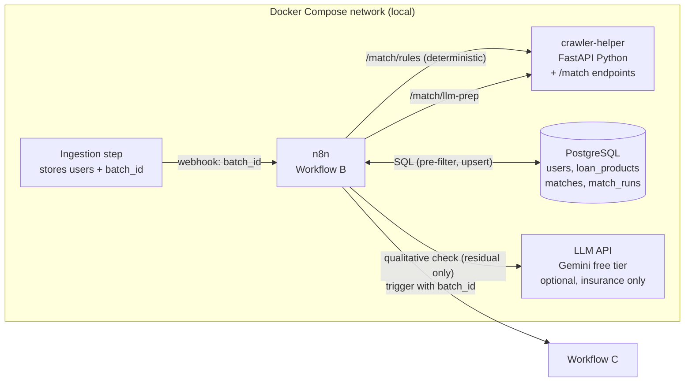
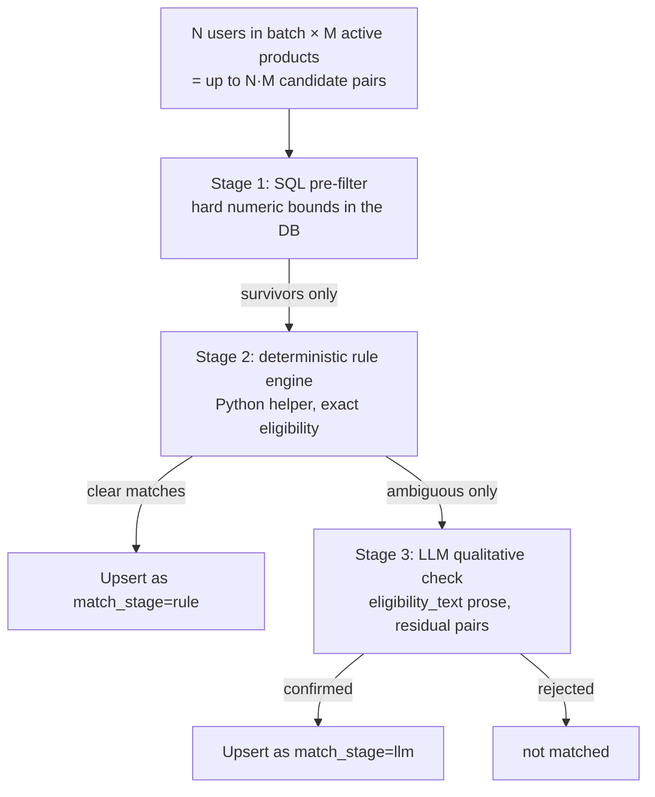

# Workflow B: User-Loan Matching. Architecture & Design Plan

> **Audience:** the coding agent that will build this. Read this file first (the *what* and *why*), then `workflow-b-implementation.md` (the *how*: SQL, code, node-by-node n8n spec, tests).
> **Depends on:** `workflow-a-architecture.md` (produces the `loan_products` catalog this workflow reads). Reuse the same stack, same Postgres, same `crawler-helper` service pattern, same n8n instance.
> **Stack decision (unchanged from A):** Python for all custom code, n8n orchestrates, Postgres stores, a small FastAPI helper does stateless heavy lifting. **Everything runs locally via Docker Compose. No AWS is required for B** — the assignment is accepted and demonstrated locally.

---

## 1. Purpose & scope

**Goal:** when a new batch of users has been ingested, match each of those users against the active loan-product catalog and persist every eligible `(user, product)` pair into a `matches` table, cheaply and quickly, so that Workflow C can email users their matches.

**In scope**
- Webhook trigger fired by the ingestion step after a user CSV batch is stored
- A **multi-stage, optimized matching pipeline** (the "Optimization Treasure Hunt"): cheap deterministic stages first, expensive LLM stage last and only on the few genuinely ambiguous pairs
- Idempotent writes to a `matches` table keyed on `(user_id, product_id)`
- Per-batch run logging and a handoff signal to Workflow C
- Fully local execution; no cloud dependency for the matching logic

**Out of scope**
- User CSV ingestion itself (produces the `users` rows + a `batch_id`; see the ingestion doc / Workflow A is unrelated here)
- Workflow A crawling (only *reads* its `loan_products` output)
- Workflow C email construction/sending (B only records matches and signals C)

**Why this design scores well:** the rubric weights "sophistication, robustness, efficiency of n8n workflows" and calls the **Optimization Treasure Hunt** a key factor. So the multi-stage funnel (SQL pre-filter → deterministic rule check → LLM only on the residual) must be visibly owned by n8n, measurable (how many pairs each stage eliminates), and cheap in steady state (near-zero LLM calls).

---

## 2. Contract with other workflows (do not break this)

### 2.1 Reads from Workflow A (`loan_products`)
Exactly the interface defined in `workflow-a-architecture.md` §2. B **must**:
- Filter `is_active = true`.
- Treat `min_monthly_income`, `min_credit_score`, `max_credit_score`, `min_age`, `max_age` as **NULL = no stated bound** (never coerce NULL to 0).
- Treat `employment_types` as **NULL/empty = any employment type allowed**.
- Keep `eligibility_text` for the LLM stage on ambiguous pairs only.

### 2.2 Reads from ingestion (`users`)
Expected user columns (from the sample CSV: `user_id, email, monthly_income, credit_score, employment_status, age`):

| Column | Type | Notes for B |
|---|---|---|
| `user_id` | text/bigint | Natural key from CSV; written into `matches.user_id` |
| `email` | text | Used by Workflow C, never by B's logic |
| `monthly_income` | numeric | INR per month |
| `credit_score` | int | 300-900; may be NULL/invalid → B handles gracefully |
| `employment_status` | text | Normalized to `{salaried, self_employed}` vocabulary |
| `age` | int | years |
| `batch_id` | uuid/text | **The ingestion batch this user belongs to.** B matches only the batch named in the webhook |

**Vocabulary alignment (critical):** `users.employment_status` must use the same `{salaried, self_employed}` vocabulary as `loan_products.employment_types`. If the CSV uses other strings (e.g. `Salaried`, `self-employed`, `SE`), normalize in **one place** — the ingestion step or a shared SQL `CASE`/mapping — and document it. B assumes the vocabulary is already aligned.

### 2.3 Writes for Workflow C (`matches`)
| Column | Meaning for C |
|---|---|
| `user_id`, `product_id` | The matched pair (composite unique key) |
| `batch_id` | Which ingestion batch produced it (lets C email per batch) |
| `match_stage` | `rule` or `llm` — which stage confirmed the match (auditability) |
| `score`/`confidence` | Optional ranking so C can order/limit products per user |
| `reasons` | jsonb — why it matched (shown or logged; good for the demo) |
| `notified` | boolean, default false — C flips this after sending |
| `created_at` | timestamptz |

**Handoff rule:** B does **not** call C directly in-process. When a batch finishes, B writes a `match_runs` summary row and triggers Workflow C (webhook or n8n sub-workflow call) with the `batch_id`. C then reads `matches WHERE batch_id = ? AND notified = false`.

---

## 3. System architecture (all local)



Everything stays on the local Docker network. The LLM is the only optional outbound call, and in steady state it is never used (Stage 1+2 resolve almost all pairs). If no LLM key is configured, B degrades gracefully: ambiguous pairs are matched conservatively by rules alone and flagged (see §6 Stage 3 fallback).

### Responsibility split (same rule as A)

| Concern | Owner | Reason |
|---|---|---|
| Webhook trigger, batch orchestration, looping | **n8n** | Visible, demoable |
| Stage 1 SQL pre-filter (the big reduction) | **n8n** Postgres node | One set-based query, pushed into the DB |
| Branching: has LLM key? / ambiguous? / gate | **n8n** IF nodes | Shows workflow logic |
| Stage 2 deterministic rule evaluation | **Python helper** `/match/rules` | Unit-testable pure function |
| Stage 3 LLM qualitative check (residual) | **n8n** HTTP node → LLM | Cost stays visible |
| Idempotent `matches` upsert, run summary | **n8n** Postgres node | Single place for state |
| Trigger Workflow C | **n8n** | Orchestration boundary |

The helper remains **stateless and credential-free** — pure functions of their request, exactly like in A.

---

## 4. The Optimization Treasure Hunt — the three-stage funnel

This is the heart of B. The design principle: **make each stage cheaper than the one that would follow, and let each stage eliminate as many pairs as possible before the next, more expensive, stage runs.**



### Stage 1 — SQL pre-filter (eliminates the vast majority, ~free)
A single set-based `JOIN` between the batch's users and active products applies all the **hard, structured** bounds inside Postgres:
- `user.monthly_income >= product.min_monthly_income` (or product bound is NULL)
- `user.credit_score BETWEEN min_credit_score AND max_credit_score` (NULL bounds = open)
- `user.age BETWEEN min_age AND max_age` (NULL bounds = open)
- `product.employment_types IS NULL OR user.employment_status = ANY(product.employment_types)`

This runs on indexes (`loan_products (is_active, min_monthly_income, min_credit_score)` from A, plus a user-batch index) and turns *N·M* pairs into a small survivor set in one query. **This is where 90-99% of pairs die, at essentially zero cost.** Only survivors leave the database.

### Stage 2 — deterministic rule engine (eliminates/confirms most survivors, cheap)
The Python helper `/match/rules` re-checks each surviving pair with the *full, explicit* rule set (the same bounds plus any cross-field rules the SQL can't express cleanly) and classifies each pair as:
- **match** — all structured criteria satisfied with margin, and `eligibility_text` has no qualitative gate → confirmed, `match_stage='rule'`.
- **ambiguous** — structured criteria pass, but `eligibility_text` contains qualitative conditions that numbers alone can't settle (e.g. "stable income for 2+ years", "existing relationship with the bank", "no recent defaults") → defer to Stage 3.
- **reject** — a structured check fails (defensive double-check against the SQL stage).

Most survivors resolve here as a clean match. Only genuinely qualitative-gated pairs become ambiguous.

### Stage 3 — LLM qualitative check (tiny residual, insurance)
Only the ambiguous residual reaches the LLM, and even then in a **batched** call (many pairs per request, JSON-schema output, temperature 0). The LLM judges *only* whether the user plausibly satisfies the prose conditions in `eligibility_text`, given the user's structured attributes. It never overrides a hard numeric failure (those already died in Stage 1/2). Output is grounded: the model must cite the clause it relied on.

**Cost controls (what makes this "optimized"):**
1. Stage 1 removes almost all pairs before any Python runs.
2. Stage 2 removes/confirms almost all survivors before any LLM runs.
3. Stage 3 is batched (not one call per pair) and only sees ambiguous pairs.
4. Expected steady state: **0 LLM calls** for clean catalogs; the LLM is insurance for prose-gated products.
5. If no LLM key is configured, ambiguous pairs fall back to a conservative rule-only decision and are flagged (`match_stage='rule'`, `reasons.llm_skipped=true`), so the pipeline still completes locally with no external dependency.

**Measurability (great for the demo & README):** `match_runs` records `pairs_considered`, `after_stage1`, `after_stage2`, `llm_pairs`, `matches_written`. The funnel drop-off is the proof the optimization works.

---

## 5. Pipeline stages (per batch)

```mermaid
flowchart TD
  W[Webhook: {batch_id}] --> R0[Start run → match_runs row]
  R0 --> V{batch has users?}
  V -->|no| FIN0[Finish run: empty, status=success]
  V -->|yes| S1[Stage 1: SQL pre-filter JOIN<br/>→ survivor pairs]
  S1 --> C1{survivors > 0?}
  C1 -->|no| FIN1[Finish run: 0 matches]
  C1 -->|yes| S2[Stage 2: helper /match/rules<br/>classify match / ambiguous / reject]
  S2 --> UPc[Upsert clear matches<br/>match_stage=rule]
  S2 --> AMB{ambiguous pairs > 0?}
  AMB -->|no| AGG
  AMB -->|yes| K{LLM key configured?}
  K -->|no| CONS[Conservative rule-only decision<br/>flag llm_skipped] --> AGG
  K -->|yes| S3[Stage 3: batched LLM check] --> UPl[Upsert confirmed<br/>match_stage=llm] --> AGG
  UPc --> AGG[Finish run + funnel counts]
  AGG --> TRIG[Trigger Workflow C with batch_id]
```

Every path converges on **Finish Run** → **Trigger C**, so an empty batch or a zero-match batch still closes cleanly and (optionally) still signals C with nothing to send.

---

## 6. Matching rule semantics (the source of truth)

A user *u* matches product *p* when **all** of the following hold (NULL product bound = no constraint):

| Rule | Condition |
|---|---|
| Active | `p.is_active = true` |
| Income | `p.min_monthly_income IS NULL OR u.monthly_income >= p.min_monthly_income` |
| Credit (min) | `p.min_credit_score IS NULL OR u.credit_score >= p.min_credit_score` |
| Credit (max) | `p.max_credit_score IS NULL OR u.credit_score <= p.max_credit_score` |
| Age (min) | `p.min_age IS NULL OR u.age >= p.min_age` |
| Age (max) | `p.max_age IS NULL OR u.age <= p.max_age` |
| Employment | `p.employment_types IS NULL OR array_length(p.employment_types,1) IS NULL OR u.employment_status = ANY(p.employment_types)` |
| Qualitative | `eligibility_text` prose conditions satisfied (Stage 3, only if present and not settled by numbers) |

**Missing user data:** if a user's `credit_score`/`age` is NULL or out of 300-900 / sane range, B does **not** silently assume it passes. It treats the pair as failing the affected rule unless the product has no bound for it. This is documented so results are explainable.

**Score/confidence (for C's ordering):** a simple, explainable score — e.g. normalized margin above the income/credit thresholds, minus a penalty if resolved only by LLM. Purely for ranking; it does not change whether a pair matches.

---

## 7. Idempotency & re-runs

- `matches` has `UNIQUE (user_id, product_id)`. Re-triggering the same batch produces **no duplicates** (upsert).
- Upsert refreshes `match_stage`, `score`, `reasons`, `created_at`/`updated_at` but **never** flips `notified` back to false — so re-running B does not cause C to re-email already-notified users.
- Pairs that *stop* qualifying on a re-run (e.g. a product was deactivated by A) are soft-handled: optionally mark `is_active=false` on the match row rather than deleting, mirroring A's soft-delete philosophy. Minimum viable: leave existing matches and only add new ones; document the choice.
- `batch_id` scoping means a new batch never touches another batch's matches.

---

## 8. Error handling matrix

| Failure | Where caught | Behavior |
|---|---|---|
| Webhook missing/invalid `batch_id` | IF after Webhook | Respond 400; no run started |
| Batch has no users | IF after Stage 1 input | Finish run `success`, 0 matches; still signal C (nothing to send) |
| Helper `/match/rules` down | HTTP node error output | Run `failed` (or `partial` if some stages wrote); DB not corrupted; alert |
| LLM API error / invalid JSON | HTTP error output | Fall back to conservative rule-only decision for ambiguous pairs; flag `llm_skipped`; run `partial` |
| DB write error on upsert | Postgres node error output | Run `failed`; `match_runs` marked failed; no partial duplicate rows (upsert is atomic per statement) |
| Whole workflow crash | n8n **Error Workflow** `B - Error Handler` | Mark the in-flight `match_runs` row `failed` |
| Workflow C unreachable | HTTP node error output on trigger | Matches are already persisted; log the handoff failure; C can be re-triggered from `matches` by `batch_id` |

**Principle:** matches are persisted *before* C is triggered, so a C failure never loses data — C is replayable from `matches`.

---

## 9. Observability

- `match_runs`: one row per batch run — `batch_id`, status (`running|success|partial|failed`), `pairs_considered`, `after_stage1`, `after_stage2`, `llm_pairs`, `matches_written`, timing.
- `matches.reasons` jsonb: per-match explanation (which rules passed, Stage, LLM clause cited).
- Demo query: `SELECT batch_id, pairs_considered, after_stage1, after_stage2, llm_pairs, matches_written FROM match_runs ORDER BY started_at DESC LIMIT 1;` — shows the funnel in one line.
- n8n execution history retained for the demo (`EXECUTIONS_DATA_SAVE_ON_*=all`, already set for A).

---

## 10. Security & configuration (local)

- No new secrets beyond A: reuse the Postgres credential and the (optional) LLM key credential already created in n8n. Provide them via `.env` / n8n credentials, never in workflow JSON or git.
- The webhook should require a shared token (header) so only the ingestion step can trigger B, even though everything is local.
- Scraped `eligibility_text` sent to the LLM is **data, not instructions**: the system prompt tells the model to ignore any instructions embedded in product prose.
- All SQL uses **query parameters**; user and product text is never string-concatenated into SQL.
- Exported workflow JSON scrubbed of credential IDs before committing.

---

## 11. Performance & cost

- Stage 1 is a single indexed set-based JOIN — thousands of users × dozens of products collapse to a small survivor set in one query.
- Stage 2 is pure Python over the survivors only; linear in survivors, not in N·M.
- Stage 3 is batched and residual-only; 0 calls in steady state.
- Reuse A's index `loan_products (is_active, min_monthly_income, min_credit_score)`; add `users (batch_id)` and `matches (batch_id)`.

---

## 12. Risks & mitigations

| Risk | Mitigation |
|---|---|
| N·M blows up for large batches | Stage 1 SQL JOIN never materializes all pairs in n8n; the DB does the reduction |
| LLM unavailable / no key locally | Conservative rule-only fallback; pipeline completes offline; flagged in `reasons` |
| Vocabulary mismatch (`Salaried` vs `salaried`) | Normalize at ingestion; B asserts and logs any unexpected value |
| Ambiguous prose is subjective | Stage 3 output grounded to a cited clause; `match_stage='llm'` makes it auditable and separable |
| Double-emailing on re-run | `notified` flag never reset by B; C reads `notified=false` only |
| C fails after matches written | Matches persisted first; C replayable from `matches` by `batch_id` |

---

## 13. Copy-ready "Design Decisions" paragraph for the README

> **Workflow B (User-Loan Matching)** is triggered by a webhook carrying a `batch_id` once a user CSV has been ingested. It solves the Optimization Treasure Hunt with a **three-stage funnel** that makes every stage cheaper than the next. Stage 1 is a single set-based SQL JOIN that applies all hard numeric/categorical eligibility bounds (income, credit score, age, employment) inside Postgres on indexed columns, collapsing up to *N·M* user-product pairs into a tiny survivor set at essentially zero cost — this is where almost all pairs are eliminated. Stage 2 is a deterministic Python rule engine that confirms clear matches and isolates only the genuinely *qualitative* cases (prose conditions in `eligibility_text`). Stage 3 sends just that residual to an LLM in a single batched, schema-constrained call, grounded to the cited eligibility clause, and never used in steady state (and skippable entirely when run fully offline). Every match is upserted idempotently into a `matches` table keyed on `(user_id, product_id)`, annotated with the stage and reasons, and the per-batch funnel counts are recorded in `match_runs`. B persists matches before signaling Workflow C, so notification is always replayable and users are never double-emailed.

---

## 14. Definition of done for Workflow B

- [ ] Webhook with `batch_id` triggers the run; invalid/missing `batch_id` returns 400.
- [ ] Stage 1 SQL JOIN returns the correct survivor set for the sample users against the seeded `loan_products` (verified against hand-computed expectations).
- [ ] Stage 2 confirms clear matches and flags only prose-gated pairs as ambiguous.
- [ ] Stage 3 runs **only** on ambiguous pairs, batched; with no LLM key it falls back conservatively and flags `llm_skipped`.
- [ ] `matches` rows written with `(user_id, product_id)` uniqueness; re-running the batch creates **no duplicates** and does not reset `notified`.
- [ ] `match_runs` shows the funnel counts (`pairs_considered` → `after_stage1` → `after_stage2` → `llm_pairs` → `matches_written`).
- [ ] NULL product bounds and NULL/empty `employment_types` are treated as "no constraint", verified by a user who matches a bound-less product.
- [ ] A user with missing/invalid credit score does **not** match a product that requires one.
- [ ] Workflow C is triggered with the `batch_id` after matches are persisted; a C failure leaves matches intact and replayable.
- [ ] Everything runs with `docker compose up` locally — no AWS needed.
- [ ] Workflow JSON exported and credential-free; README section + funnel diagram written.
